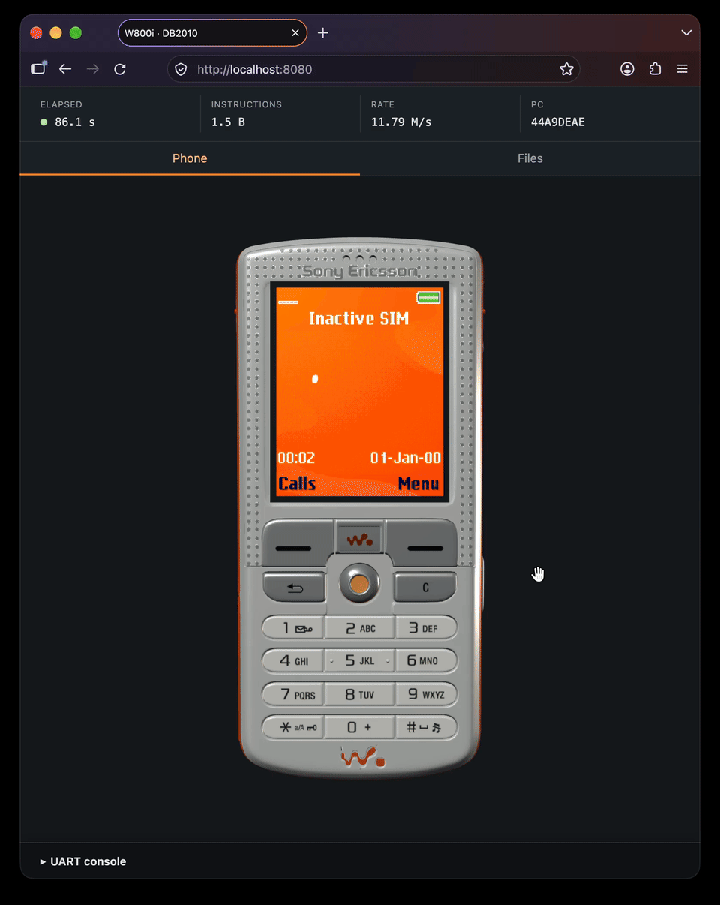

# DB2010 emulator

A QEMU-based emulator for the Sony Ericsson W800i, with a Python host runner
and browser UI. Default cold boots use provisioned W800 R1L002 CID49 flash.



## Hardware support

| Peripheral / part | MMIO range or interface | Status | Key facts |
| --- | --- | --- | --- |
| Boot ROM / bootloader | Hardware-reset mapping and handoff to MAIN unresolved | 🔴 | Original boot code unavailable; execution starts directly at MAIN's reset handler |
| NOR — Intel L18-compatible profile | `0x44000000–0x45FFFFFF` | 🟢 | 32 MiB; ID `89/880D`; read/program/erase; fitted part unverified |
| NAND — Samsung EC/35-compatible profile | Controller: `0x50000000–0x50000FFF` | 🟢 | 32 MiB plus spare data; logical storage range `0x50000000–0x51FFFFFF` is accessed through ports; no wear |
| DMA — PL080-style | `0xF2000000–0xF2000FFF` | 🟡 | Supported display and FA transfer paths |
| Timers, IRQ controller and RTC | Timers: `0xF9010000–0xF901001F`; IRQ banks: `0xFB020100–0xFB02039B`; RTC block: `0xF9050000–0xF905005F` | 🟡 | Selected registers, native interrupts and calendar; declared timing/reset assumptions |
| Missing ROM services — SHA/KGEN/ETX | Selected `0xFFFFxxxx` ROM call entries; **not MMIO** | 🟡 | Synthetic services; two GDFS digest read overlays; exact entries in usage guide |
| LCD — R61500 profile / RNH 942 29 module | PDI: `0xF7000100–0xF70001FF`; stream registers: `0xF7000300–0xF700030B` | 🟢 | 176×220 RGB565 through PDI/DMA; controller profile identified in firmware |
| Keypad, joystick and side keys | Matrix: `0xFB010000–0xFB010003`; selected GPIO registers in `0xF9000000–0xF900006D`; power contact at `0xF9050058` | 🟢 | Ideal contacts processed by firmware; physical shutdown absent |
| PMIC — Vincenne2 A07, ROP 101 3066/2 | I²C controller: `0xF9040000–0xF9040FFF`; 7-bit slave `0x4A` | 🟡 | Scoped transactions, register latches and synthetic inputs; analog behavior incomplete |
| UARTs / serial data | UART0: `0xFB060000–0xFB06002F`; UART1: `0xFC040000–0xFC04002D`; UART3: `0xFC030000–0xFC03002F`; UART4: `0xFB040000–0xFB04002D` | 🟢 | Four captures; UART0 file transfer or debug mode; selected registers only |
| SIM interface / synthetic card | `0xF9060000–0xF9060FFF` | 🟡 | Native byte/IRQ interface and dummy GSM files; no subscriber authentication |
| Bluetooth | Through UART3: `0xFC030000–0xFC03002F` | 🟡 | Initialization-failure peer; no functional Bluetooth service |
| FM radio | Through I²C at `0xF9040000–0xF9040FFF`; 7-bit slave `0x10` | 🟡 | Scoped write sink; no tuning or radio audio |
| Memory Stick | Selected registers in `0xFC010008–0xFC01002D`; GPIO42 detection | 🟡 | Empty-slot behavior; no card transfers |
| DSP / audio service peer — C55x candidate | Selected FA registers in `0xFA040000–0xFA0400BF` | 🟡 | No DSP instruction execution; host MP3/AAC-LC services; EQ arithmetic absent |
| MIDI synthesizer — DSP service | Through the FA/DSP interface; no separate MMIO block | 🟡 | Host triangle synthesis: 40 voices, timed guest events, velocity/volume, pause/stop/loop and checkpoint support; original instruments/banks absent |
| Camera | No identified camera device mapping | 🔴 | Focus/shutter contacts work; image capture absent |
| USB | Selected startup captures in `0xFD000004–0xFD0000FD` | 🔴 | No enumeration or packet transport |
| Cellular radio/network | No functional RF/network device mapping | 🔴 | No registration or calls |

## Setup

Requires Python 3.14+ with venv/pip support, available as `python3`.

On Linux (Debian/Ubuntu), install the build dependencies below. Install Python
3.14+ separately if needed:

```sh
sudo apt install git build-essential ninja-build pkg-config libglib2.0-dev \
  libpixman-1-dev zlib1g-dev libffi-dev
```

On macOS, use [Homebrew](https://brew.sh) and
[Python 3.14](https://formulae.brew.sh/formula/python@3.14):

```sh
xcode-select --install
brew install python@3.14 ninja pkgconf glib pixman
export PATH="$(brew --prefix python@3.14)/libexec/bin:$PATH"
```

Then clone, install and build on either platform (SSH access to GitHub required):

```sh
git clone git@github.com:danylokos/db2010.git
cd db2010
python3 -m venv .venv && source .venv/bin/activate
python -m pip install -e '.[dev]'
python -m db2010.development.source init
python -m db2010.development.build --jobs 4
```

## Run

```sh
python -m db2010 --ui
```

Use `--help` for more options.

See [advanced usage and troubleshooting](docs/usage.md) for controls, SSH,
diagnostics, traces, persistent state, GDB and testing, and
[firmware provenance](fw/README.md) for bundled image identities and assumptions.
